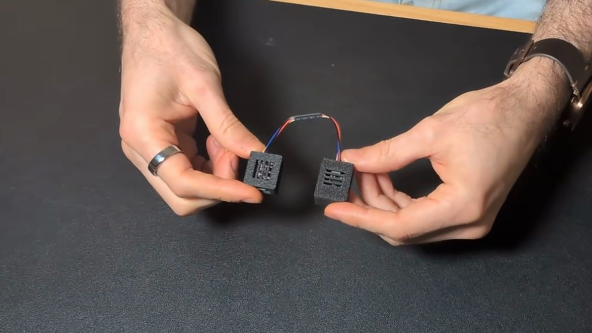

```
Clone https://github.com/rdmayo21/claude-code-bedside-sensor and follow its AGENTS.md to set up a bedside temperature and humidity logger for me.
```

# A bedside temperature and humidity logger, built with Claude Code

Companion to the video **[I Used Claude Code to Build a Bedroom Temperature & Humidity Logger](https://youtu.be/yvZeJ0IxNFY)**.

A thumb-sized sensor by the bed reads the room's temperature and humidity every 30 seconds
from 21:30 to 07:30 with its Wi-Fi **off**, keeps the night in memory, and each morning uploads
it to a small receiver on your computer as one CSV file. In the video the point was to line the
bedroom up against sleep-tracker data and see whether a warm or humid room goes with waking up
at night.



```
QT Py ESP32 + SHT41  ── Wi-Fi, once, after 07:30 ──>  bedside_receiver.py on your computer
 by the bed, USB power                                  ~/bedside-sensor/nights/<time>_night-<date>.csv
```

## Set it up: hand it to your agent

Paste the line at the top of this page into your AI coding agent (Claude Code, Codex, Gemini CLI,
Cursor, any of them). It does everything it can and stops only for what needs you: installing
a compiler if your computer lacks one, typing your Wi-Fi password, plugging the board in,
printing the case and putting it by the bed. [AGENTS.md](AGENTS.md) is the full runbook, with a
check after every step and a table of failures and fixes.

<details><summary>By hand instead</summary>

1. Tools: `arduino-cli`, `uv`, `python3` (3.9+), a C++ compiler. Then `./esp32_sensor/firmware.sh setup` and `./check.sh`.
2. Receiver: `python3 receiver/bedside_receiver.py --make-token`, then `python3 receiver/bedside_receiver.py` (leave it running), and `python3 receiver/bedside_receiver.py --test-upload` in another terminal.
3. Settings: `./esp32_sensor/make_device_config.sh` (asks for your 2.4 GHz Wi-Fi name and password).
4. Plug the board in with a USB-C data cable and run `./esp32_sensor/firmware.sh flash`.
5. Keep the receiver running at login: `receiver/install_service.sh`.

</details>

## What you need

| Part | Price (Oct 2026) |
|---|---|
| [Adafruit QT Py ESP32 Pico, 8 MB flash / 2 MB PSRAM](https://www.adafruit.com/product/5395) (#5395) | $14.95 |
| [Adafruit SHT41 temperature and humidity sensor, STEMMA QT](https://www.adafruit.com/product/5776) (#5776) | $5.95 |
| [STEMMA QT / Qwiic JST SH 4-pin cable, 100 mm](https://www.adafruit.com/product/4210) (#4210) | $0.95 |
| A USB-C **data** cable (for flashing) and any USB charger (for the bedside) | already owned |
| Optional: the printed case, about 8 g of PLA | |

About $22 plus shipping. Also: a computer that is on and on the same home network most
mornings (macOS or Linux), and a 2.4 GHz Wi-Fi network (the board cannot join 5 GHz-only ones).
No soldering.

## How it works

- **No radio at night.** Wi-Fi is off 21:30 to 07:30. The only exceptions: one connection at
  power-up to set the clock, and short check-ins after problems (both outside the window unless
  you plug it in at night).
- **Nothing to remember.** Readings go into RAM (about 3.3 nights). After 07:30 the board
  connects, re-syncs its clock, POSTs each finished night, and turns Wi-Fi off. A failed upload
  retries every hour, so a computer that was asleep at 07:30 still gets the night later.
- **Finding your computer.** By its `.local` name over mDNS; if your router blocks that, by a
  fixed address you set (`RECEIVER_IP`); after that, by the last address that worked.
- **Telling you when something is wrong.** Every power-up, failed upload and run of bad sensor
  reads leaves a `GET /bedside/hello?...` line in the receiver's log with the reset reason, rows
  held, last error and signal strength. A watchdog restarts a hung board.
- **The files.** One CSV per night, `time_local,epoch,temp_c,rh_pct`, about 1,200 rows, named by
  the evening the night started. On the night the clocks go back, `time_local` repeats an hour:
  sort and plot by `epoch`.
- **The case.** Two parts on the 100 mm cable: a vented pod for the sensor and a case for the
  board, so the board's warmth stays away from the sensor. The SHT41 has an always-on green LED;
  the video's fix is a small piece of black tape over it.

Ask your agent to chart a night, or to compare it with your sleep tracker's export: the files
are plain CSV.

## What was tested, and what was not

- **On real hardware by the author's bed (since October 2026):** the firmware this repo is
  based on, flashed with these scripts' originals, uploading nights on its own. The first
  night: 1,194 rows from 21:33 to 07:29, no gap over 30 s. It also logged straight through the
  daylight-saving change on Oct 31. The receiver it uploaded to is this receiver's original,
  run at login on a Mac.
- **Changed for this repo, and not yet run on a board:** settings moved into `device_config.h`
  (time zone, the receiver's name, an optional fixed address and port, all filled in by
  `make_device_config.sh`), the receiver now answers the check-ins with 200, and its folders and
  options are generic. This build compiles for the board (33% of flash) and passes the logic
  tests, the receiver tests and a simulated upload over HTTP.
- **The case:** the STL files here are byte-identical to the ones printed in PLA for the video.
  The fit is checked in CAD against Adafruit's board models, and the real boards measured within
  ruler accuracy of them. The video's lids were superglued on.
- **Agents:** a fresh agent followed AGENTS.md from a clean clone up to the first step that
  needs a board.
- **Not tested:** Linux (written for it, never run there), `install_service.sh` loading a login
  service, and a full night from this exact build. If something is off, open an issue.

```bash
./check.sh              # logic tests, receiver tests, firmware compile
./check.sh --enclosure  # also rebuild the case and check the fit (CadQuery)
```

## Changing it

- Logging window: `START_MIN` / `END_MIN` in `esp32_sensor/logic.h` (and the test next to it).
- The case: `enclosure/enclosure.py` (CadQuery); `./check.sh --enclosure` rebuilds `enclosure/print/`.
- Port, output folder: see "Changing things" in [AGENTS.md](AGENTS.md).

## Credits and license

- Board models in `enclosure/ref/`: [adafruit/Adafruit_CAD_Parts](https://github.com/adafruit/Adafruit_CAD_Parts),
  MIT license, Copyright (c) Adafruit Industries. The SHT40 model stands in for the SHT41 (same board outline).
- Libraries used at build time: [Arduino core for ESP32](https://github.com/espressif/arduino-esp32),
  [Adafruit SHT4x](https://github.com/adafruit/Adafruit_SHT4X).
- Everything else: MIT, see [LICENSE](LICENSE).
- Not affiliated with Adafruit or Anthropic.
